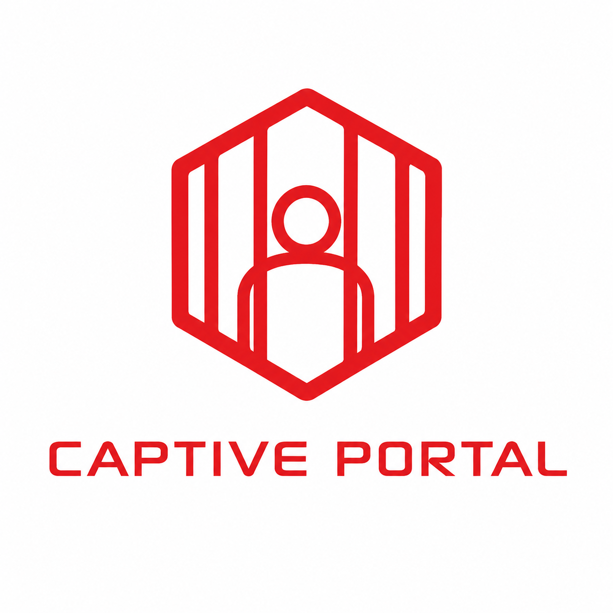
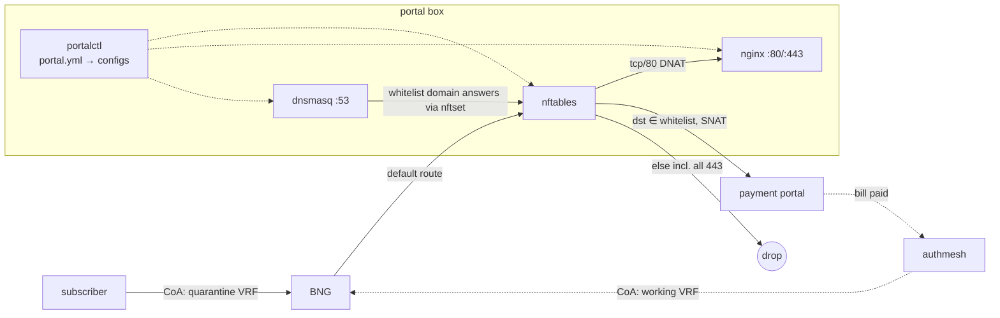

<p align="center">
  
</p>

# captive-portal

Walled-garden portal for [authmesh]. Unpaid subscriber gets CoA'd into a
quarantine VRF whose only route is this box. Box intercepts HTTP → pay page,
whitelists the payment networks, drops the rest. Paid → CoA back. No
per-subscriber state on the box.

nginx + nftables + dnsmasq do the work; `portalctl` (Python) renders their
configs from one YAML and hot-reloads on change.



Detection probes (`/generate_204` etc.) hit the catch-all and get an
unexpected answer → OS pops the sign-in sheet. HTTPS can't be intercepted
without cert errors (nobody can), so it's dropped; DoT :853 gets a TCP RST so
strict clients fail fast. `GET /capport` serves RFC 8908 JSON — only useful
once the BNG advertises it via DHCP option 114.

## Run

```sh
cp config/portal.yml.example config/portal.yml
vi config/portal.yml
docker compose up -d --build
```

`portalctl watch` re-renders and applies on every `portal.yml` change.
Invalid config → rejected, previous state kept. One-offs:
`docker compose run --rm portalctl {validate|render|apply}`.

## Config

```yaml
static_page:
  enable: true            # serve your own HTML from www/
redirect:                 # optional override: 302 everything here instead
  url: https://pay.example/portal
portal:
  listen_ip: 10.255.0.1   # this box, inside the quarantine VRF
  fqdn: portal.example
  # tls: {cert: ..., key: ...}   # HTTPS for the portal fqdn only
whitelist:
  networks: [203.0.113.0/24]
  domains: [pay.example]  # resolved live, fed to nftables via dnsmasq nftset
dns:
  upstreams: [1.1.1.1]
interfaces:
  subscriber: eth1
  wan: eth0
```

Payment links in your `www/` HTML must point at whitelisted destinations.

## Host

```sh
sudo cp host/sysctl.d/*   /etc/sysctl.d/
sudo cp host/modules-load.d/* /etc/modules-load.d/
sudo cp host/modprobe.d/* /etc/modprobe.d/
sudo modprobe nf_conntrack && sudo sysctl --system
```

This stack filters forwarded traffic only — input policy is yours. On the
subscriber interface allow tcp/80 (+443 if tls), udp+tcp/53 to `listen_ip`,
ICMP; block the rest (SSH included). Manage via the mgmt interface.

Stateless per subscriber → scale out with ECMP on the VRF default route. A
2–4 vCPU VM handles tens of thousands of quarantined subs; tune conntrack via
the sysctl file above.

## Sandbox

Full stack in containers — no host networking, no host nftables. Simulated
subscriber (netshoot), gateway netns running the portal, fake paysite.

```sh
docker compose -f docker-compose-sandbox.yml up -d --build
./scripts/sandbox-test.sh          # 8 checks: intercept, drop, whitelist, dns
docker compose -f docker-compose-sandbox.yml exec subscriber bash
```

## Dev

```sh
cd portalctl
uv sync && uv run pytest    # schema + golden-file tests
```

Templates live in `portalctl/portalctl/templates/`. Goldens in
`portalctl/tests/golden/` — delete after intentional template changes and
re-run pytest to regenerate.
